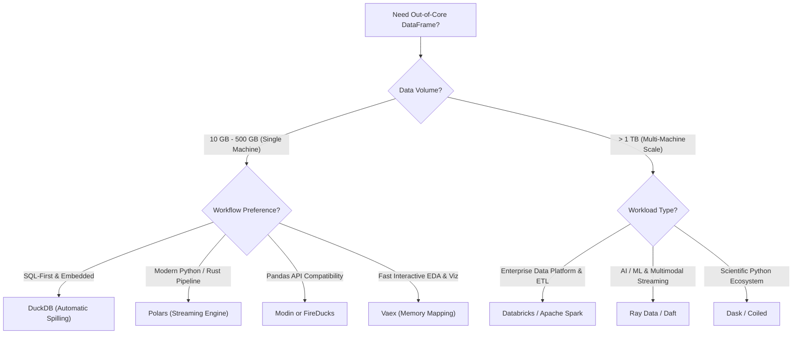

<div align="center">



# ⚡ Awesome Out-Of-Core DataFrames 📊

### *Curated List of High-Performance SaaS Platforms & Open-Source Out-of-Core DataFrame Engines*
**Process Billions of Rows Beyond Physical RAM • Lazy Evaluation • Streaming Engines • Memory-Mapped Analytics**

<p align="center">
  <a href="https://github.com/ishandutta2007/Awesome-Awesome-Awesome"></a>
  <a href="https://discord.gg/jc4xtF58Ve"></a>
  <a href="https://github.com/ishandutta2007/Awesome-Out-Of-Core-Dataframes/stargazers"></a>
  <a href="https://github.com/ishandutta2007/Awesome-Out-Of-Core-Dataframes/network/members"></a>
  <a href="https://opensource.org/licenses/MIT"></a>
  <a href="http://makeapullrequest.com"></a>
  <a href="https://github.com/ishandutta2007/Awesome-Out-Of-Core-Dataframes/graphs/commit-activity"></a>
  <a href="https://github.com/ishandutta2007"></a>
</p>

</div>

---

## 📖 Introduction & Technical Context

Welcome to the **Awesome Out-Of-Core DataFrames** ecosystem directory. When tabular datasets outgrow physical Random Access Memory (RAM), standard in-memory DataFrame libraries (such as vanilla pandas) crash with `MemoryError` (OOM). 

**Out-of-Core computation** (external memory processing) circumvents physical memory boundaries through:
- ⚡ **Lazy Evaluation & Logical Query Planning**: Postponing materialization until execution, pruning unused columns and pushing down filters directly to disk files.
- 💾 **Disk Spilling & Paging**: Seamlessly streaming intermediate result buffers to NVMe/SSD storage when working sets exceed memory quotas.
- 🗂️ **Zero-Copy Memory-Mapping (mmap)**: Mapping Arrow and HDF5 binary representations into virtual address space without memory duplication.
- 🌊 **Chunked Streaming Pipelines**: Processing chunks iteratively via SIMD-accelerated, multithreaded CPU/GPU kernels.

Whether you are an analytics engineer analyzing multi-gigabyte Parquet partitions on a laptop or a machine learning team preprocessing multi-terabyte datasets across cloud nodes, this curated repository indexes the industry leaders.

---

## 📑 Table of Contents

- [🌐 Sector Overview & Market Dynamics](#-sector-overview--market-dynamics)
- [🏢 Enterprise SaaS & Managed Cloud Platforms](#-enterprise-saas--managed-cloud-platforms)
- [🚀 Top Open-Source Out-of-Core DataFrames](#-top-open-source-out-of-core-dataframes)
- [📊 Architectural Comparison Matrix](#-architectural-comparison-matrix)
- [💡 Architectural Decision Guide](#-architectural-decision-guide)
- [❓ Frequently Asked Questions (FAQ)](#-frequently-asked-questions-faq)
- [🤝 How to Contribute](#-how-to-contribute)
- [📈 Star History](#-star-history)
- [💖 Support & Sponsoring](#-support--sponsoring)
- [📄 License & Disclaimer](#-license--disclaimer)

---

## 🌐 Sector Overview & Market Dynamics

The global **Big Data Processing & Modern Analytics Infrastructure Ecosystem** is valued at approximately **$340 Billion in 2026** and projected to exceed **$750+ Billion by 2032**, compounding at an estimated **CAGR of ~14.2%** driven by enterprise telemetry, real-time feature stores, and generative AI data preprocessing.

The market reflects a **bimodal, two-tier competitive structure**:
- **Moderately Concentrated Infrastructure Layer (Winner-Takes-Scale)**: Managed cloud data warehouses and unified analytics platforms (Google Cloud BigQuery, Snowflake, Databricks) command enterprise data storage and broad analytical governance due to massive capital moats, unified IAM, and elastic serverless clusters.
- **Highly Fragmented Execution Engine Layer (Open Standards & Modularity)**: The DataFrame execution layer is fiercely competitive, dynamic, and open-source-first. The widespread standardization around **Apache Arrow columnar format**, **Parquet storage**, and **Rust/C++ query kernels** has allowed high-speed specialized engines—such as **DuckDB**, **Polars**, **DataFusion**, **Ray Data**, and **Daft**—to displace monolithic cluster compute for single-node workloads, democratizing larger-than-RAM processing without vendor lock-in.

---

## 🏢 Enterprise SaaS & Managed Cloud Platforms

The following enterprise platforms provide turnkey, managed out-of-core data processing, serverless query execution, and distributed cluster operations.

> **Sorted by Company Valuation / Scale (Descending)**

| 🏢 Platform | 💰 Company Scale / Valuation | ⚙️ Out-of-Core Capabilities & Architecture | 💵 Starting Tier Pricing | 🎁 Free Tier / Trial Limits |
|:---|:---|:---|:---|:---|
| [**Google Cloud BigQuery**](https://cloud.google.com/bigquery) | **~$2.2 Trillion Market Cap** (Alphabet / ~$40B Cloud ARR) | Serverless petabyte-scale data warehouse with native **BigQuery DataFrames (`bigframes`)**. Implements pandas & scikit-learn compatible APIs transpiled to distributed BigQuery SQL execution without local RAM constraints. | **$6.25 per TB** scanned (On-Demand query analysis) or **$0.04 per slot-hour** (Standard Edition auto-scaling slots). | **Free Forever Tier**: 10 GB active storage/month + 1.0 TB query analysis/month at zero cost. New users receive a **90-day trial with $300 in free cloud credits**. |
| [**Snowflake**](https://www.snowflake.com/) | **~$50 Billion Market Cap** / ~$3.6B Annual Revenue (NYSE: `SNOW`) | Multi-cluster shared data architecture with **Snowpark DataFrames** (Python, Java, Scala). Computes out-of-core data transformations server-side with automatic memory paging and disk spilling across elastic virtual warehouses. | **$2.00 per Snowflake Credit** (Standard Edition On-Demand compute capacity) + cloud storage from $23.00/TB/month. | **30-Day Free Trial** loaded with **$400 in usage credits** for compute and storage exploration. |
| [**Databricks**](https://www.databricks.com/) | **$43 Billion Valuation** / ~$2.4B+ Annualized ARR | Lakehouse platform powered by **Apache Spark**, Delta Lake, and the **Photon vectorized C++ engine**. The enterprise benchmark for scaling out-of-core PySpark DataFrames across distributed multi-node clusters. | **$0.07 per Databricks Unit (DBU)** for Standard Data Engineering Jobs ($0.15/DBU for Automated, $0.40/DBU for All-Purpose interactive compute) + cloud VM pass-through. | **Databricks Community Edition** is **100% free forever** (includes 1 micro-cluster with 15 GB RAM, 2 vCPUs, Spark environment). Also includes a **14-day full enterprise trial**. |
| [**Anyscale**](https://www.anyscale.com/) | **$1.0 Billion Valuation** (Unicorn / $259M funding) | Enterprise managed platform for **Ray** and **Ray Data**, built by the creators of Ray. Streams multi-terabyte tabular, image, and multimodal data out-of-core into distributed machine learning training and inference pipelines. | **$0.05 per Anyscale Compute Unit (ACU)/hour** on pay-as-you-go tier (above underlying cloud compute costs). | **$50 in free compute credits** granted upon registration, valid for **30 days**. |
| [**MotherDuck**](https://motherduck.com/) | **$400 Million Valuation** (Series A $52.5M) | Serverless cloud analytics platform built on **DuckDB**. Features dual-engine hybrid query execution—seamlessly routing and spilling data between local DuckDB laptop instances and serverless cloud DuckDB instances with zero-copy Arrow data exchange. | **$0.10 per DuckDB Compute Unit (DCU)**; Standard production plan starts at **$50.00/month** (includes 500 DCUs). | **Free Forever Tier**: Includes **10 GB shared cloud storage** and **$10 in compute credits (100 DCUs)** refreshed each calendar month. |
| [**Coiled**](https://www.coiled.io/) | **~$50 Million Valuation** (Series A $26M) | Instant serverless **Dask** cluster management in your own cloud account (AWS/GCP/Azure), founded by Dask author Matthew Rocklin. Provisions elastic out-of-core Dask DataFrames from 1 to 10,000+ cores on demand with zero devops overhead. | **$0.05 per CPU core-hour** (billed per second) on top of standard cloud provider VM rates. | **Community Free Forever Tier**: **10,000 CPU core-hours free every month** with no expiration date. |

---

## 🚀 Top Open-Source Out-of-Core DataFrames

Explore the premier open-source libraries enabling out-of-core computation, streaming processing, and memory-mapped analytics.

> **Sorted by GitHub Stars (Descending)**

### 1. [Apache Spark (PySpark)](https://github.com/apache/spark) [](https://github.com/apache/spark/stargazers)
* **GitHub Repository**: [apache/spark](https://github.com/apache/spark) • **License**: Apache-2.0 • **Core Language**: Scala / Java / Python / C++
* 🌟 **Key Out-of-Core Capabilities**:
  - The battle-tested global standard for distributed cluster computing, processing petabytes across thousands of nodes.
  - **Tungsten execution engine** manages off-heap memory explicitly and automatically spills partition data to disk when memory pools are saturated.
  - PySpark DataFrames provide lazy query execution plans optimized via the **Catalyst Optimizer** (projection pruning, predicate pushdown, join reordering).
* 🎯 **Best For**: Large-scale enterprise ETL, multi-terabyte cluster environments, and production big data platforms.

---

### 2. [Ray (Ray Data)](https://github.com/ray-project/ray) [](https://github.com/ray-project/ray/stargazers)
* **GitHub Repository**: [ray-project/ray](https://github.com/ray-project/ray) • **License**: Apache-2.0 • **Core Language**: C++ / Python
* 🌟 **Key Out-of-Core Capabilities**:
  - Purpose-built streaming data loader and processor designed for distributed AI/ML training, batch inference, and unstructured/multimodal pipelines.
  - Implements **streaming block-based execution**: streams disjoint dataset blocks across worker nodes and spills unreferenced object store buffers to local disk.
  - Seamless zero-copy integration with PyTorch, TensorFlow, vLLM, and Ray Train.
* 🎯 **Best For**: ML/DL data preparation, multi-modal ingestion (video, audio, text embeddings), and distributed Ray pipelines.

---

### 3. [DuckDB](https://github.com/duckdb/duckdb) [](https://github.com/duckdb/duckdb/stargazers)
* **GitHub Repository**: [duckdb/duckdb](https://github.com/duckdb/duckdb) • **License**: MIT • **Core Language**: C++
* 🌟 **Key Out-of-Core Capabilities**:
  - Often dubbed the *"SQLite for Analytics"*; embedded vectorized OLAP engine that runs natively inside your Python or CLI process.
  - **Automatic, rock-solid out-of-core disk spilling**: when memory usage approaches `SET max_memory`, DuckDB gracefully buffers intermediate aggregation and join hash tables to temporary disk storage.
  - Directly queries Parquet, CSV, and Arrow files over local disks or remote S3 buckets without loading them into memory upfront.
  - Native zero-copy data interchange with Apache Arrow, Polars, and pandas.
* 🎯 **Best For**: Fast single-node SQL analytics, embedded local analysis on multi-gigabyte files, and serverless data pipelines without cluster maintenance.

---

### 4. [Polars](https://github.com/pola-rs/polars) [](https://github.com/pola-rs/polars/stargazers)
* **GitHub Repository**: [pola-rs/polars](https://github.com/pola-rs/polars) • **License**: MIT • **Core Language**: Rust / Python
* 🌟 **Key Out-of-Core Capabilities**:
  - High-performance, Rust-native DataFrame library built from the ground up on Apache Arrow memory structures and SIMD vectorization.
  - **Dedicated Streaming Engine**: enables processing datasets far larger than physical RAM in discrete morsels/chunks via `LazyFrame.collect(engine="streaming")` or `LazyFrame.sink_parquet()`.
  - Advanced query optimizer performs aggressive projection and predicate pushdown, parallel chunked execution, and multi-threaded partition processing.
  - Drastically lower memory overhead and 10x-50x faster execution than pandas for standard aggregation, join, and filtering benchmarks.
* 🎯 **Best For**: Modern single-machine Python/Rust data pipelines, fast ETL, and high-throughput data munging.

---

### 5. [Dask](https://github.com/dask/dask) [](https://github.com/dask/dask/stargazers)
* **GitHub Repository**: [dask/dask](https://github.com/dask/dask) • **License**: BSD-3-Clause • **Core Language**: Python
* 🌟 **Key Out-of-Core Capabilities**:
  - Scales familiar Python scientific computing primitives (`pandas.DataFrame`, `numpy.ndarray`) across multi-core CPUs and distributed clusters.
  - Partitioned DataFrame architecture coordinates directed acyclic graphs (DAGs) of tasks, streaming individual partitions through memory and evicting them to disk when completed.
  - Flexible schedulers: threaded scheduler for numeric/NumPy code, multi-process scheduler for GIL bypass, and distributed scheduler with rich telemetry web dashboards.
* 🎯 **Best For**: Scaling existing pandas and NumPy workflows to 100GB+ datasets on a workstation or multi-node cloud clusters.

---

### 6. [Modin](https://github.com/modin-project/modin) [](https://github.com/modin-project/modin/stargazers)
* **GitHub Repository**: [modin-project/modin](https://github.com/modin-project/modin) • **License**: Apache-2.0 • **Core Language**: Python
* 🌟 **Key Out-of-Core Capabilities**:
  - Drop-in pandas replacement: change a single import (`import modin.pandas as pd`) to parallelize pandas queries across all CPU cores.
  - Employs an omnidirectional 2D partitioning system that distributes rows and columns across Ray or Dask backends.
  - Out-of-core memory spilling delegating to Ray's plasma object store or Dask's disk-spill mechanisms when memory limits are reached.
* 🎯 **Best For**: Teams needing instant speedups and larger-than-RAM capabilities on legacy pandas codebases without refactoring API calls.

---

### 7. [NVIDIA cuDF (RAPIDS)](https://github.com/rapidsai/cudf) [](https://github.com/rapidsai/cudf/stargazers)
* **GitHub Repository**: [rapidsai/cudf](https://github.com/rapidsai/cudf) • **License**: Apache-2.0 • **Core Language**: C++ / CUDA / Python
* 🌟 **Key Out-of-Core Capabilities**:
  - GPU-accelerated DataFrame library providing pandas-compatible APIs executed on NVIDIA tensor/CUDA cores.
  - **cuDF-pandas Accelerator Mode**: seamlessly runs existing pandas code on GPU when advantageous and automatically falls back to CPU out-of-core memory when GPU VRAM boundaries are surpassed.
  - Integrates with Dask-CUDA for distributed out-of-core GPU multi-node processing across terabytes of data.
* 🎯 **Best For**: Workstations and GPU servers requiring 100x acceleration for data preprocessing and tabular feature engineering.

---

### 8. [Apache DataFusion](https://github.com/apache/datafusion) [](https://github.com/apache/datafusion/stargazers)
* **GitHub Repository**: [apache/datafusion](https://github.com/apache/datafusion) • **License**: Apache-2.0 • **Core Language**: Rust
* 🌟 **Key Out-of-Core Capabilities**:
  - Extensible, embedded, vectorized SQL query and DataFrame engine implemented in Rust using Apache Arrow as memory format.
  - Features configurable memory managers with built-in disk spilling operators for hash aggregation, sort, and hash joins.
  - Serves as the foundational execution core behind modern data systems (including Ballista, InfluxDB 3.0, and Comet for Spark).
* 🎯 **Best For**: Systems engineers building custom out-of-core analytics engines, database backends, and low-latency Arrow micro-engines.

---

### 9. [Vaex](https://github.com/vaexio/vaex) [](https://github.com/vaexio/vaex/stargazers)
* **GitHub Repository**: [vaexio/vaex](https://github.com/vaexio/vaex) • **License**: MIT • **Core Language**: C++ / Python
* 🌟 **Key Out-of-Core Capabilities**:
  - Pioneer of **zero-copy memory-mapping (`mmap`)** for tabular big data; opens billion-row HDF5 and Arrow datasets in milliseconds without memory footprint.
  - Lazy evaluation model: column transformations, filtering, and mathematical operations compute virtual expressions on-the-fly without data duplication.
  - Vectorized statistics, 3D volume rendering, interactive heatmap calculations, and sub-second aggregations on a single machine.
* 🎯 **Best For**: Exploratory data analysis (EDA), interactive visualization, and statistical modeling on massive datasets without spinning up cloud clusters.

---

### 10. [Ibis](https://github.com/ibis-project/ibis) [](https://github.com/ibis-project/ibis)
* **GitHub Repository**: [ibis-project/ibis](https://github.com/ibis-project/ibis) • **License**: Apache-2.0 • **Core Language**: Python
* 🌟 **Key Out-of-Core Capabilities**:
  - Unified, portable Python dataframe API that compiles expressions into backend-native execution across 20+ query engines.
  - Lets developers write a single DataFrame pipeline and transparently execute it out-of-core on DuckDB locally, Polars streaming, ClickHouse, BigQuery, Snowflake, or PySpark without modifying business logic.
  - Zero lock-in: decouple DataFrame code semantics from underlying execution runtime.
* 🎯 **Best For**: Data teams wanting portable DataFrame code that easily transitions from local laptop testing (via DuckDB) to cloud production scale.

---

### 11. [Daft](https://github.com/Eventual-Inc/Daft) [](https://github.com/Eventual-Inc/Daft/stargazers)
* **GitHub Repository**: [Eventual-Inc/Daft](https://github.com/Eventual-Inc/Daft) • **License**: Apache-2.0 • **Core Language**: Rust / Python
* 🌟 **Key Out-of-Core Capabilities**:
  - Distributed Rust-based query engine engineered explicitly for multimodal data (images, tensors, video, audio, PDFs, text) and tabular data.
  - Built on Apache Arrow with Ray integration; provides a Python DataFrame interface with streaming chunked execution and memory safety.
  - Native support for vector embeddings, cloud object storage (S3/GCS/Azure), and streaming ML batch inference without OOM crashes.
* 🎯 **Best For**: AI data pipelines, multimodal feature extraction, and high-throughput computer vision / NLP data processing.

---

### 12. [H2O DataTable](https://github.com/h2oai/datatable) [](https://github.com/h2oai/datatable/stargazers)
* **GitHub Repository**: [h2oai/datatable](https://github.com/h2oai/datatable) • **License**: MPL-2.0 • **Core Language**: C++ / Python
* 🌟 **Key Out-of-Core Capabilities**:
  - Inspired by R's renowned `data.table`; high-speed 2D tabular manipulation in Python optimized for performance and memory economy.
  - Built-in out-of-core file reading through memory-mapping and native binary disk cache format (`.jay`).
  - Native multi-threaded C++ engine handling multi-gigabyte joins, aggregations, and sorting on single machines.
* 🎯 **Best For**: Users familiar with R's `data.table` syntax wanting lightweight, fast out-of-core dataset munging in Python.

---

### 13. [FireDucks](https://github.com/fireducks-dev/fireducks) [](https://github.com/fireducks-dev/fireducks/stargazers)
* **GitHub Repository**: [fireducks-dev/fireducks](https://github.com/fireducks-dev/fireducks) • **License**: Custom Permissive • **Core Language**: C++ / Python
* 🌟 **Key Out-of-Core Capabilities**:
  - JIT-compiled drop-in accelerator for pandas providing up to **20x speedup** on standard data wrangling benchmarks.
  - Employs intermediate representation (IR) construction and define-by-run lazy evaluation to eliminate redundant memory allocations.
  - Automatically converts pandas query chains into optimized multi-threaded native C++ execution kernels.
* 🎯 **Best For**: Developers seeking effortless execution speedups on existing pandas scripts without learning a new API.

---

## 📊 Architectural Comparison Matrix

| Project | 🛠️ Implementation Language | 🧠 Execution Model | 💾 Out-of-Core Mechanism | 📐 Primary API | ⚖️ License |
|:---|:---|:---|:---|:---|:---|
| **Apache Spark** | Scala / Java / C++ | Distributed Cluster DAG | Tungsten off-heap disk spilling | PySpark / SQL / Scala | Apache-2.0 |
| **Ray Data** | C++ / Python | Distributed Streaming Actors | Object store spilling to disk | Python / Ray API | Apache-2.0 |
| **DuckDB** | C++ | Vectorized Embedded Engine | Automatic temp disk spilling | SQL / Python / R / Node | MIT |
| **Polars** | Rust | Multi-Threaded Streaming | Streaming chunk sink & collect | Python / Rust / R | MIT |
| **Dask** | Python | Task Graph Scheduler | Partition-level disk eviction | pandas-like / NumPy-like | BSD-3-Clause |
| **Modin** | Python | Distributed 2D Partitions | Ray / Dask engine spilling | pandas drop-in | Apache-2.0 |
| **cuDF** | CUDA / C++ / Python | GPU SIMT Kernel Execution | Unified memory & CPU spillback | pandas-like API | Apache-2.0 |
| **DataFusion** | Rust | Vectorized Pull/Push Pipeline | Configurable disk spilling | SQL / Rust / Python | Apache-2.0 |
| **Vaex** | C++ / Python | Memory-Mapped Lazy Graph | Zero-copy `mmap` + virtual cols | Python DataFrame | MIT |
| **Ibis** | Python | Abstract Syntax Tree Compiler | Delegates to engine backend | Unified Python DataFrame | Apache-2.0 |
| **Daft** | Rust / Python | Distributed Multimodal Engine | Chunked streaming & Ray spill | Python DataFrame | Apache-2.0 |
| **H2O DataTable** | C++ / Python | Multi-Threaded Native C++ | `mmap` reading & `.jay` format | Python `dt` syntax | MPL-2.0 |
| **FireDucks** | C++ / Python | JIT-Compiled Lazy IR | Compiler graph optimization | pandas drop-in | Proprietary / Free |

---

## 💡 Architectural Decision Guide

When selecting an out-of-core solution, evaluate your primary system constraints:



* **Speed on Single Laptop / Workstation**: Choose **Polars** (via streaming engine) or **DuckDB**. Both run locally without daemon overhead and handle datasets 5x–10x physical RAM smoothly.
* **Pure SQL Interface**: Choose **DuckDB** for instantaneous Parquet/CSV file querying and seamless disk spilling.
* **Zero Code Changes to pandas**: Use **Modin** or **FireDucks** as drop-in accelerations.
* **Petabyte Scale & Enterprise Clusters**: Choose **Databricks / Apache Spark** for unified cluster orchestration, governance, and mature data warehousing.
* **Deep Learning & Multimodal Data (Audio, Images, Embeddings)**: Choose **Ray Data** or **Daft**.
* **Exploratory Visual Analytics on 1B+ Rows**: Choose **Vaex** to benefit from instantaneous zero-copy memory mapping.

---

## ❓ Frequently Asked Questions (FAQ)

### What defines an "Out-of-Core" DataFrame?
An out-of-core DataFrame library processes tabular datasets that exceed available physical RAM (Random Access Memory). Rather than attempting to allocate the entire dataset into memory simultaneously—which causes fatal `Out-Of-Memory` (OOM) errors—out-of-core engines employ techniques such as **disk spilling**, **chunked streaming pipelines**, and **zero-copy virtual memory mapping (`mmap`)**.

### How does Memory Mapping differ from Disk Spilling?
- **Memory Mapping (`mmap`)**: Maps file bytes directly into the operating system's virtual memory address space. The OS kernel loads pages from disk on demand and discards clean pages when memory pressure builds. This enables instantaneous dataset loading (e.g., in **Vaex** or Arrow files) but relies heavily on columnar file formats without data transformation.
- **Disk Spilling**: The query execution engine actively tracks RAM consumption during computationally heavy operations (such as hash joins, sorts, or group-bys). When allocated memory thresholds are reached, the engine writes temporary intermediate data chunks to disk and reads them back in subsequent merge phases (e.g., in **DuckDB**, **Polars**, and **Spark**).

### When should I choose Single-Machine Out-of-Core over a Distributed Cluster?
Distributed clusters (like multi-node Spark or Ray) introduce network serialization overhead, cluster orchestration complexity, worker failure handling, and high cloud costs. For datasets between **10 GB and 1 TB**, modern vectorized single-machine engines (like **DuckDB** or **Polars**) running on a 16-core or 32-core workstation with high-speed NVMe drives frequently run **faster and cheaper** than a multi-node cluster, with zero devops overhead.

---

## 🤝 How to Contribute

Contributions are warmly welcomed! Help expand and refine this ecosystem directory:

1. 🍴 **Fork the repository** to your GitHub account.
2. 🌿 **Create a feature branch**:
   ```bash
   git checkout -b feature/add-new-out-of-core-tool
   ```
3. 📝 **Add or update your entry** in `README.md`:
   - Keep descriptions factual, technical, and objective.
   - For open-source repos, include proper GitHub links and the stargazer badge.
   - For SaaS platforms, provide specific pricing tiers and free plan limitations.
4. 🚀 **Commit and submit a Pull Request**:
   ```bash
   git commit -m "Add [Tool Name] to out-of-core open-source section"
   git push origin feature/add-new-out-of-core-tool
   ```

---

## 📈 Star History

[](https://star-history.dera.page/#ishandutta2007/Awesome-Out-Of-Core-Dataframes&type=date&legend=top-left)

---

## 💖 Support & Sponsoring

If you find this curated out-of-core DataFrame ecosystem resource valuable:
- ⭐ **Star this repository** to show your support and improve discovery for other data engineers!
- 🍴 **Fork and contribute** your benchmark insights, architectural diagrams, and tool additions.
- 📢 **Share this project** on LinkedIn, X (Twitter), Reddit, and developer Discord communities.
- ☕ **Support ongoing maintenance**: You can sponsor this project directly via the [GitHub Sponsors Dashboard](https://github.com/sponsors/ishandutta2007).

<div align="center">
  <a href="https://github.com/sponsors/ishandutta2007">
    
  </a>
</div>

---

## 📄 License & Disclaimer

* **License**: Released under the [MIT License](LICENSE).
* **Disclaimer**: This directory is an independent, community-maintained resource. Trademarks and brand names belong to their respective owners. Performance characteristics and out-of-core capabilities vary depending on hardware configuration, disk I/O throughput, schema characteristics, and memory tuning parameters.

---

<div align="center">
  <sub>Curated with ❤️ by <a href="https://github.com/ishandutta2007">Ishan Dutta</a> and the open-source data engineering community.</sub>
</div>
